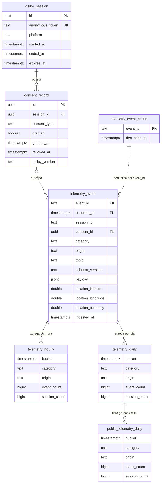

# Diagrama de relacionamento da série temporal

Este diagrama representa as tabelas e visões definidas em
[`query_serieTemporal.sql`](../postgres/init/query_serieTemporal.sql).

## Interpretação

- `visitor_session` possui vários registros de `consent_record`.
- `consent_record` pode ser associado a vários eventos por `consent_id`.
  Como `telemetry_event.consent_id` é opcional, um evento pode não ter esse
  vínculo físico.
- `telemetry_event` é a hypertable central, particionada diariamente por
  `occurred_at`.
- `telemetry_event_dedup` controla a unicidade global de `event_id`, mas não
  possui chave estrangeira declarada para `telemetry_event`; essa relação é
  lógica e é aplicada pelo fluxo de ingestão.
- `telemetry_event.session_id` também representa uma associação lógica com a
  sessão, pois é `text` e não possui `FOREIGN KEY` para `visitor_session.id`.
- `telemetry_hourly` e `telemetry_daily` são agregações contínuas derivadas de
  `telemetry_event`.
- `public_telemetry_daily` é uma visão sobre `telemetry_daily` e publica apenas
  grupos com pelo menos dez sessões.

## Regra de localização

Para eventos de sensor originados pelo aplicativo, somente latitude, longitude
e precisão são persistidas. Luminosidade, movimento, acelerômetro e demais
leituras permanecem no dispositivo e não aparecem como colunas no banco.
