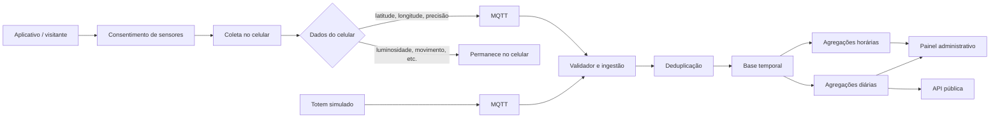
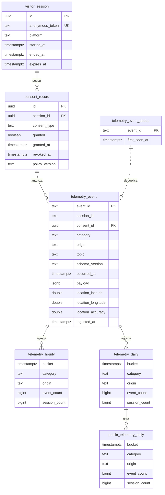

# Organização da série temporal - Iteração 3

## Objetivo

Documentar a modelagem da camada de telemetria do DSM Conecta, com foco na iteração 3 do projeto: ingestão assíncrona, validação, deduplicação, persistência em banco temporal, particionamento, retenção e agregação.

A proposta segue a regra de minimização de dados: do sensor do celular, somente latitude, longitude e precisão são armazenados; os demais sensores ficam no próprio dispositivo e não são gravados no banco.

---

## 1. Visão do fluxo

### Fluxo principal

1. O visitante autoriza o uso dos sensores.
2. O aplicativo coleta apenas os dados necessários para presença/localização.
3. O sensor simulado do totem publica contagens e eventos de presença.
4. As mensagens são enviadas ao broker MQTT.
5. O módulo de ingestão valida estrutura, categoria, origem, schema e timestamp.
6. Mensagens duplicadas são ignoradas.
7. O evento válido é escrito na base temporal.

---

## 2. Regra de privacidade e minimização

### Dados que entram no banco

Para sensores do celular, persistimos somente:

- latitude
- longitude
- precisão (accuracy)

Esses campos só devem ser gravados quando houver consentimento explícito do usuário e quando a coleta estiver vinculada à presença ou localização.

### Dados que ficam no celular

Os demais sensores não são enviados para o banco, por exemplo:

- luminosidade
- acelerômetro
- movimento
- outros dados do dispositivo que não tenham uso analítico direto

Essa regra evita coleta excessiva e mantém o sistema alinhado à LGPD e ao princípio de minimização.

---

## 3. Modelo temporal

A base de série temporal deve seguir o padrão de eventos temporais com particionamento por tempo.

### Entidades principais

- `visitor_session`: sessão anônima do visitante
- `consent_record`: registro de consentimento
- `telemetry_event_dedup`: controle de duplicidade por `event_id`
- `telemetry_event`: fato bruto da telemetria
- `telemetry_hourly`: agregação contínua por hora
- `telemetry_daily`: agregação contínua por dia
- `public_telemetry_daily`: visão pública filtrada

### Estrutura do evento

Cada evento bruto conserva:

- `event_id`
- `session_id`
- `category`
- `origin`
- `topic`
- `schema_version`
- `occurred_at`
- `ingested_at`
- `payload`
- `location_latitude`
- `location_longitude`
- `location_accuracy`

A coluna `occurred_at` é o eixo principal do particionamento. O `ingested_at` registra o momento em que o servidor recebeu o evento, preservando a origem temporal do dado.

---

## 4. Particionamento e retenção

### Particionamento

O particionamento temporal ocorre em intervalos de um dia, usando `occurred_at` como chave de divisão.

Isso permite:

- consultas rápidas por janela de tempo;
- retenção seletiva por intervalo;
- compactação de dados antigos;
- melhor escalabilidade com volume crescente.

### Política proposta

- 0 a 30 dias: dados brutos disponíveis para operação e reprocessamento
- 30 a 90 dias: compressão dos dados brutos
- após 90 dias: remoção automática dos fatos brutos
- agregações horárias e diárias: mantidas por prazo maior, conforme necessidade analítica

### Justificativa

A retenção curta dos fatos brutos reduz custo de armazenamento sem perder a rastreabilidade operacional. As agregações permanecem mais tempo para dashboards, relatórios e comparação histórica.

---

## 5. Agregações

A camada analítica não substitui os fatos brutos. Ela reduz o volume de dados para consultas de painel.

### Agregação horária

Resposta a perguntas como:

- quantos eventos ocorreram na última hora;
- quantas sessões ativas houve;
- qual categoria foi mais frequente;
- qual origem gerou mais volume.

### Agregação diária

Resposta a perguntas como:

- tendência do interesse por conteúdo;
- variação de participação por dia;
- distribuição de resultados do quiz;
- acompanhamento de presença por evento.

### Publicação pública

A visão pública só deve expor dados agregados e anonimizados, com filtro de grupo mínimo de 10 sessões.

---

## 6. Relacionamento entre tabelas

### Observações

- `telemetry_event_dedup` é o controle de duplicidade separado do fato bruto.
- `telemetry_event` é a tabela central e o principal eixo da série temporal.
- `telemetry_hourly` e `telemetry_daily` são agregações derivadas, não fontes primárias.
- `public_telemetry_daily` aplica a regra de anonimização pública.

---

## 7. Riscos e controles

### Risco

Coleta excessiva de sensores do celular ou armazenamento de dados não previstos.

### Controle

- limitar o payload persistido a latitude, longitude e precisão;
- manter os demais sensores na camada local;
- exigir consentimento explícito antes da coleta;
- manter `session_id` anônimo e sem vínculo pessoal;
- aplicar filtros de agregação pública.

---

## 8. Escopo da iteração 3

### Entregáveis esperados

- serviço de ingestão assíncrono;
- validação e deduplicação de mensagens;
- persistência em série temporal;
- particionamento por tempo;
- política de compressão e retenção;
- carga sintética com volume relevante;
- relatórios de desempenho e análise comparativa.

### Fora de escopo

- dashboard final público completo;
- regras de apresentação visual no painel;
- exportação final do painel administrativo em produção;
- processamento completo de inteligência analítica avançada.

---

## 9. Conclusão

A iteração 3 deve focar na base temporal correta: o banco deve receber apenas o necessário, preservar a origem do evento e permitir consultas rápidas por janela temporal. O desenho proposto mantém a telemetria com mínima coleta, preservação analítica e política clara de retenção, alinhando arquitetura, privacidade e requisitos do projeto.
